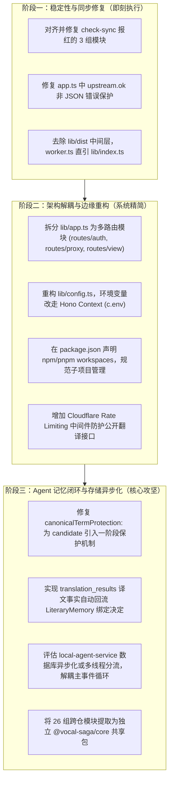

# vocal-saga 项目架构与系统深度分析评估报告

**审计日期**：2026-11-23  
**仓库版本**：v0.6.2 (Commit: `0479dd4`)  
**审计范围**：Cloudflare Workers 边缘代理与网页翻译（`lib/`, `src/`）、本地长文档/文学翻译服务（`local-agent-service/`）、跨项目同步架构（与 `fanyi-extension` 契约）、数据持久化（KV / D1 / SQLite）、Agent 记忆与并发管线。

---

## 目录

1. [执行概要 (Executive Summary)](#1-执行概要-executive-summary)
2. [重大问题与架构缺陷总览 (Issue Matrix)](#2-重大问题与架构缺陷总览-issue-matrix)
3. [核心架构与工程缺陷深度剖析](#3-核心架构与工程缺陷深度剖析)
   - [缺陷一：跨仓库代码复制与同步脱节（高危维护性缺陷）](#缺陷一跨仓库代码复制与同步脱节高危维护性缺陷)
   - [缺陷二：文学翻译 Agent Memory 专名译名漂移缺陷（高危业务质量缺陷）](#缺陷二文学翻译-agent-memory-专名译名漂移缺陷高危业务质量缺陷)
   - [缺陷三：`lib/app.ts` 单体上帝文件与路由架构退化（高危架构缺陷）](#缺陷三libappts-单体上帝文件与路由架构退化高危架构缺陷)
   - [缺陷四：边缘无状态设计破坏：模块全局变量与单例模式（中度架构缺陷）](#缺陷四边缘无状态设计破坏模块全局变量与单例模式中度架构缺陷)
   - [缺陷五：双重编译链路与幽灵产物 `lib/dist`（中度工程缺陷）](#缺陷五双重编译链路与幽灵产物-libdist中度工程缺陷)
   - [缺陷六：本地 Agent 同步阻塞式 SQLite 阻塞 Node 事件循环（中度性能隐患）](#缺陷六本地-agent-同步阻塞式-sqlite-阻塞-node-事件循环中度性能隐患)
   - [缺陷七：伪单体仓库缺乏工作区编排（中度工程管理缺陷）](#缺陷七伪单体仓库缺乏工作区编排中度工程管理缺陷)
   - [缺陷八：上游代理错误解析脆弱性与状态码掩蔽（中度可靠性缺陷）](#缺陷八上游代理错误解析脆弱性与状态码掩蔽中度可靠性缺陷)
   - [缺陷九：公开翻译端点无速率限制与配额防护（中度安全隐患）](#缺陷九公开翻译端点无速率限制与配额防护中度安全隐患)
4. [重构实施路线图与行动建议 (Remediation Roadmap)](#4-重构实施路线图与行动建议-remediation-roadmap)

---

## 1. 执行概要 (Executive Summary)

`vocal-saga` 是一个定位极其清晰且技术密度极高的多端翻译生态核心。它涵盖了：
1. **边缘层**：运行在 Cloudflare Workers 上的 Hono 代理，提供 URL 翻译、双语 HTML 回填、文档片段处理与 OpenAI 兼容的 LLM 代理；
2. **本地层 (`local-agent-service`)**：运行在 Node.js 环境下的 Express 服务，基于 SQLite、Context Graph、TranslationBrief 和 Agent 调度管线，专攻整本小说/EPUB/PDF 的长文本一致性文学翻译与中文单语编辑。

从测试与类型安全来看，项目质量基线较高：
- Cloudflare Worker 单元测试：**73 个测试文件，849 个测试用例全部通过**；
- Local Agent 单元测试：**357 个测试用例全部通过**；
- 根项目与本地 Agent 的 `tsc --noEmit` 均零错误通过。

**然而，代码库在架构演进中积累了显著的结构性债务**：
核心痛点集中在**跨仓库代码复制导致同步校验失败、文学翻译核心记忆系统存在并行波次译名分叉缺陷、Worker 入口呈现单体“上帝文件”、边缘环境使用全局可变配置、双重打包脱节，以及本地 Agent 同步阻塞 I/O 阻塞事件循环**。

---

## 2. 重大问题与架构缺陷总览 (Issue Matrix)

| 编号 | 模块 | 严重级 | 问题概述 | 核心影响与症状 |
| :--- | :--- | :---: | :--- | :--- |
| **F-01** | 跨项目协作 | **P1 高危** | 与 `fanyi-extension` 跨仓复制代码，当前已发生逻辑漂移 | `check-sync.ts` 校验 **FAIL**（3 组文件不一致），双端维护容易顾此失彼 |
| **F-02** | 本地 Agent | **P1 高危** | 专名译名漂移：未把采纳译文绑定为约束，未解决并行分叉 | 同一 Run 内 `Tennent` 产生 `坦嫩特` / `坦南特` 双译名，四套存储三种目标 |
| **F-03** | 边缘 Worker | **P1 高危** | `lib/app.ts` 单文件近 2,000 行，承担全量业务控制 | 混合 OAuth、D1 模板渲染、LLM 代理、URL 抓取，违背单一职责与模块化 |
| **F-04** | 边缘 Worker | **P2 中度** | `lib/config.ts` 使用模块级可变变量，违背 Worker 无状态原则 | 绕过 Hono 的 `c.env` 上下文机制，在并发与复杂 isolate 环境下存在配置穿透隐患 |
| **F-05** | 构建工程 | **P2 中度** | `src/worker.ts` 引入 `lib/dist`，依赖预先编译的双重构建路径 | 测试跑源码 TS，构建跑编译 JS；一旦漏跑 `build:lib` 导致部署与本地代码脱节 |
| **F-06** | 本地 Agent | **P2 中度** | 核心持久化全量使用同步 `DatabaseSync` (`node:sqlite`) | 长文本扫描与海量片段入库时同步阻塞 Node.js 事件循环，导致 HTTP 服务无响应 |
| **F-07** | 仓库结构 | **P2 中度** | 根目录与 `local-agent-service` 为“伪单体”，缺乏统一工作区 | 依赖与构建独立，根目录靠 `npm --prefix` 脚本胶水连接，缺乏统一规范与依赖共享 |
| **F-08** | 边缘代理 | **P2 中度** | Chat Completions 代理盲目使用 `upstream.json()` 解析错误响应 | 上游发生 502/504 HTML 故障时抛 JSON 语法错误，掩盖真实上游状态码 |
| **F-09** | 安全 / 成本 | **P2 中度** | 公开 `/translate/*` 与 `/force/*` 端点无速率限制 | 任何人均可无鉴权消耗上游付费 API Token，存在被攻击刷费用的风险 |

---

## 3. 核心架构与工程缺陷深度剖析

### 缺陷一：跨仓库代码复制与同步脱节（高危维护性缺陷）

#### 1. 现状与证据
`vocal-saga` 与前端扩展 `fanyi-extension` 两个独立 Git 仓库之间，共有 **26 组模块** 采用源码复制粘贴的方式同步（详见 [CROSS_PROJECT_SYNC.md](file:///Users/saga/code-repos/vocal-saga/CROSS_PROJECT_SYNC.md)）。

运行项目内置的同步检查脚本：
```bash
$ npx tsx scripts/check-sync.ts
```
**检查直接报错退出**：
```
═══════════════════════════════════════════════
  跨项目同步校验
═══════════════════════════════════════════════
✓ 完全一致: 22/25
✗ 有差异: 3
  ✗ translationQueue
  ✗ service/prompt-contract
  ✗ glossaryExtractor
结果: FAIL — 存在差异,请检查并同步
```

#### 2. 根因剖析
- 两个仓库的开发往往不同步进行。例如在前端扩展中修复了 `translationQueue` 的任务空指针防护 `if (!task) continue;`，但在 `vocal-saga` 这一端没有同步。
- 在 `service/prompt-contract` 中，扩展增加了 fallback 兜底：`LANGUAGE_NAMES[key.split('-')[0] ?? key]`，而服务端仍是旧代码。
- **架构缺陷**：通过手写脚本比较多仓库文件的字节级哈希是反模式。一旦一个仓库发版或重构，另一个仓库就会处于未同步的不稳定状态。

---

### 缺陷二：文学翻译 Agent Memory 专名译名漂移缺陷（高危业务质量缺陷）

#### 1. 现状与数据证据
在 2026-11-14 编写的专名漂移审查报告 [TRANSLATION-AGENT-MEMORY-NAMING-DRIFT-2026-11-14.md](file:///Users/saga/code-repos/vocal-saga/TRANSLATION-AGENT-MEMORY-NAMING-DRIFT-2026-11-14.md) 中，记录了真实项目数据库中的严重缺陷：
- 角色名 `Tennent` 在源文中出现 89 次；
- 译文中产生 **81 行“坦嫩特”** 和 **41 行“坦南特”**；
- 在同一个 Run（`4aa3b4ce`）内，由于波内并行批次互不可见，直接出现了 **19 行“坦嫩特”与 25 行“坦南特”混用**的恶劣质量问题；
- 记忆图谱中存的建议译名是“特南特”，但在实际生成的译文中出现频次为 **0**。

#### 2. 核心代码根因
尽管经过排查，但截至目前该核心缺陷依然存在于代码中：
1. **`candidate` 级别被一票否决**：
   在 [local-agent-service/src/documents/canonicalTermProtection.ts#L80-L91](file:///Users/saga/code-repos/vocal-saga/local-agent-service/src/documents/canonicalTermProtection.ts#L80-L91)：
   ```typescript
   const priorityFor = (status: unknown): number => {
     if (status === 'confirmed-memory') return 4;
     if (status === 'confirmed') return 3;
     if (status === 'auto') return 2;
     if (status === 'run-canonical') return 1;
     return 0; // candidate 映射为 0
   };
   const active = mappings.filter((mapping) => {
     if (priorityFor(sourceStatus) <= 0 || ...) return false; // candidate 直接被丢弃！
   ```
   **后果**：新出现的角色在未被手动确认前都是 `candidate`，因而无法生成 `__VSA_TERM_NNN__` 确定性掩码。
2. **缺乏译文事实的回流与绑定决定（Binding Decision）**：
   并发的各个批次分别调用 LLM，各自按概率音译。已采纳的译文（`translation_results`）只被记录在结果表，却**从未作为一个不可逆转的 Binding Decision 反哺给进行中的 Run**。
3. **真相源碎片化**：
   系统存在 4 套彼此割裂的存储结构：`context_graph_nodes`、`literary_memory_revisions`、`translation_briefs`、`translation_results`，多方写入且缺少最终仲裁机制。

---

### 缺陷三：`lib/app.ts` 单体上帝文件与路由架构退化（高危架构缺陷）

#### 1. 现象与代码规模
[lib/app.ts](file:///Users/saga/code-repos/vocal-saga/lib/app.ts) 文件体积高达 **89.6 KB**，行数多达 **1,941 行**。

#### 2. 架构失范表现
Hono 本身支持非常清晰的模块化多级路由（`app.route('/api', apiRouter)`），但 `lib/app.ts` 却违背了框架的最佳实践，将以下完全不相干的业务混合在同一个闭包函数 `createApp` 中：
1. **Instapaper OAuth 协议交互**（348–470 行）：包含 OAuth Request Token 交换、PIN 码验证、Access Token 存储。
2. **服务端 HTML 视图渲染**（825–920 行）：嵌入大段原生 HTML 模板字符串，拼装主页文章列表、分页、单篇详情页。
3. **OpenAI 兼容协议代理**（930–1027 行）：处理 Chat Completions 请求转发、流式 SSE 透传、Thinking 字段禁用补丁。
4. **扩展端专用长连接 API**（1030–1280 行）：处理 `/fanyi/page` 复杂的状态标记与双语回填检查。
5. **文档分段翻译**（1420–1740 行）：处理结构化分段。
6. **多大模型直连路由网关**（1745–1940 行）：针对 `/nvd/`, `/openrt/`, `/gemini/`, `/oc/`, `/cf/` 等不同模型的分支路由。

这使得 `lib/app.ts` 成为维护难度极高的单点瓶颈，任何边缘路由的细微调整都容易引发其他无关端点的回归。

---

### 缺陷四：边缘无状态设计破坏：模块全局变量与单例模式（中度架构缺陷）

#### 1. 现象与证据
检查 [lib/config.ts](file:///Users/saga/code-repos/vocal-saga/lib/config.ts#L10-L20)：
```typescript
let _dsApiKey = '';
let _openrouterApiKey = '';
let _nvidiaApiKey = '';
...
export function setDSApiKey(key: string) { _dsApiKey = key; }
export function getDSApiKey(): string { return _dsApiKey; }
```
检查 [lib/storage/index.ts#L18-L24](file:///Users/saga/code-repos/vocal-saga/lib/storage/index.ts#L18-L24)：
```typescript
const KEY = '__vocalSagaDefaultStorage';
export function setDefaultStorage(s: StorageAdapter): void {
  (globalThis as unknown as GlobalWithStorage)[KEY] = s;
}
```

#### 2. 架构缺陷分析
- Cloudflare Workers 的隔离模型（Isolate）可能会在多请求间复用。将环境变量通过 `createApp(env)` 提取后写入**模块全局变量**与 `globalThis`，破坏了函数式和无状态架构契约。
- Hono 框架推荐的标准解法是通过 Context 携带环境变量：
  `c.env.DEEPSEEK_API_KEY`，并在中间件中将初始化后的服务/存储注入到 `c.set('storage', ...)`。
- 当前做法不仅导致单测需要频繁手动 `clearDefaultStorage()`，还可能在未来多租户或不同 bindings 切换时出现状态污染。

---

### 缺陷五：双重编译链路与幽灵产物 `lib/dist`（中度工程缺陷）

#### 1. 现象与流程
在 [src/worker.ts#L29](file:///Users/saga/code-repos/vocal-saga/src/worker.ts#L29) 中：
```typescript
import { createApp, CloudflareKVStorage, setDefaultStorage } from '../lib/dist/index.js';
```
在 [package.json](file:///Users/saga/code-repos/vocal-saga/package.json#L7-L10) 中：
```json
"dev": "npm run build:lib && wrangler dev",
"build": "npm run build:lib",
"build:lib": "tsc -p tsconfig.lib.json",
```

#### 2. 弊端分析
- **测试与生产的分离风险**：Vitest 单元测试通过 `tsx`/`vite` 直接加载 TypeScript 源码（`lib/app.ts` 等），而实际部署的 Worker 和 `wrangler dev` 却引用 `lib/dist/index.js`（由 `tsc` 编译产出的编译后 JS）。
- **心智负担与遗漏陷阱**：一旦开发者直接用 `wrangler deploy`，或者在修改代码后直接跑本地调试而漏掉了 `build:lib`，部署上去的就是过期的代码。
- **完全冗余**：Wrangler 内部本身基于 `esbuild` 打包，原生支持直接导入 TypeScript 文件（`import { createApp } from '../lib/index.ts'`），不需要在本地再引入一套编译输出目录 `lib/dist/`。

---

### 缺陷六：本地 Agent 同步阻塞式 SQLite 阻塞 Node 事件循环（中度性能隐患）

#### 1. 现象与代码证据
[local-agent-service/src/db.ts](file:///Users/saga/code-repos/vocal-saga/local-agent-service/src/db.ts#L1) 全面使用 Node.js 22 的同步 SQLite API：
```typescript
import { DatabaseSync } from 'node:sqlite';
```
在 `projectStore.ts`、`contextGraphPersist.ts` 等全书业务层中，所有的读写都是同步调用的：
```typescript
db.prepare('SELECT ...').all(...);
db.prepare('INSERT ...').run(...);
```

#### 2. 隐患评估
- **主线程阻塞**：Node.js 是单线程事件循环架构。在处理一本数十万字的小说时，`bookScan.ts` 需要解析数百个章节并执行大量候选实体比对、词表匹配以及复杂的 SQLite 关联查询。
- **并发服务僵死**：当一个长文本分析 Run 在执行同步 SQLite 读写时，Express 服务的主线程被完全卡死，期间浏览器扩展发起的 `/health` 查询、进度轮询或取消请求都会被排队甚至超时。
- **实验性 API 依赖**：每次运行均打印 `ExperimentalWarning: SQLite is an experimental feature and might change at any time`。直接在生产核心资产库使用实验特性，在 Node 小版本升级时容易面临破坏性变更风险。

---

### 缺陷七：伪单体仓库缺乏工作区编排（中度工程管理缺陷）

#### 1. 现状
- 仓库内包含两个完全平行的项目：
  - 根目录：`translation-api`（基于 Hono, Cloudflare Workers, Vitest）
  - 子目录：`local-agent-service`（基于 Express, Node 22, `node:test`）
- 根目录的 `package.json` **并没有声明 `workspaces`**。
- 两者依赖完全割裂，根项目靠 `"local-agent:install": "npm --prefix local-agent-service install"` 等命令驱动，缺乏统一的依赖版本锁定、格式化检查与统一 CI 流程。

---

### 缺陷八：上游代理错误解析脆弱性与状态码掩蔽（中度可靠性缺陷）

#### 1. 现象与代码位置
检查 [lib/app.ts#L998-L1002](file:///Users/saga/code-repos/vocal-saga/lib/app.ts#L998-L1002)：
```typescript
if (!upstream.ok) {
  const errData = await upstream.json(); // <-- 危险操作！
  console.error(`[resp] status=${upstream.status} ...`);
  return c.json(errData, upstream.status as ...);
}
```

#### 2. 隐患分析
当上游大模型服务商（例如 DeepSeek 或 OpenRouter）遭遇基础设施故障、超时或触发 Cloudflare 边缘拦截时，返回的往往是 `502 Bad Gateway` 或 `504 Gateway Timeout` 的 **HTML 错误页面**。
- `await upstream.json()` 会直接抛出 `SyntaxError: Unexpected token '<' ...`；
- 执行流程立即跳入外层 `catch` 块，最终返回：
  `c.json({ error: 'Upstream request failed', detail: '...' }, 502)`；
- 这导致原本真实的 HTTP 状态码（如 429、504）和上游提供的具体故障信息被彻底抹杀，前端只能收到一个具有迷惑性的 JSON 解析异常。

---

### 缺陷九：公开翻译端点无速率限制与配额防护（中度安全隐患）

#### 1. 现象
- `/translate/*`、`/force/*`、`/openrt/*`、`/nvd/*` 以及 `/fanyi/page` 均为**完全免鉴权公开接口**。
- 尽管存在内存 singleflight（防止单节点对同一 URL 重复并发请求），但并没有针对客户端 IP 的 Rate Limiting 或每日使用配额限制。
- 攻击者可以轻易编写脚本向 `/force/<大量大体积外部网页>` 持续发起高频请求，耗尽服务绑定的 DeepSeek / NVIDIA 付费 API 余额，或触发 Cloudflare Worker 的子请求配额耗尽。

---

## 4. 重构实施路线图与行动建议 (Remediation Roadmap)

针对上述九大缺陷，建议分三个阶段稳步推进重构演进：



### 4.1 第一阶段：紧急修复与构建精简（1-2 天内可完成）

1. **解决跨项目同步漂移**：
   - 对齐 [lib/translate/translationQueue.ts](file:///Users/saga/code-repos/vocal-saga/lib/translate/translationQueue.ts)、`prompt-contract.ts` 与 `glossaryExtractor.ts` 中的 3 处差异，让 `npx tsx scripts/check-sync.ts` 重新变绿。
2. **修复上游代理错误容错**：
   - 在 [lib/app.ts](file:///Users/saga/code-repos/vocal-saga/lib/app.ts#L998) 中，先检查 `upstream.headers.get('content-type')`。如果是 JSON 才走 `json()`，否则走 `text()` 并构造标准错误体包装，保留原始 HTTP 状态码。
3. **消除 `lib/dist` 间接层**：
   - 将 [src/worker.ts#L29](file:///Users/saga/code-repos/vocal-saga/src/worker.ts#L29) 直接改为 `import { createApp, ... } from '../lib/index.ts';`。
   - 彻底废弃 `build:lib` 预编译步骤，避免因漏编译引发的上线与测试脱节。

### 4.2 第二阶段：边缘 Worker 模块化拆分（核心架构重整）

1. **按职责重组 `lib/app.ts`**：
   将 1,941 行的单体文件按 Hono 推荐的最佳实践拆分成清晰的子路由：
   - `lib/routes/oauth.ts`：处理 Instapaper OAuth；
   - `lib/routes/chatProxy.ts`：处理 `/api/v1/chat/completions` 与 `/api/v1/models`；
   - `lib/routes/pageTranslate.ts`：处理 `/fanyi/page` 与 `/api/translate/*`；
   - `lib/routes/urlTranslate.ts`：处理 `/translate/*`, `/force/*`, `/s/*` 等网页抓取路由；
   - `lib/routes/view.ts`：处理 D1 历史文章列表与详情的 HTML 渲染。
2. **消灭全局可变配置**：
   - 改造 `lib/config.ts`，不再向模块局部变量写值，而是编写纯函数 helper 直接从 Hono Context `c.env` 读取配置。
3. **引入端点频次保护**：
   - 在公开的 `/translate/*` 与 `/force/*` 端点上接入基于 IP 的简单防刷限制（可利用 Cloudflare KV 或 Rate Limiting API），防止恶意消耗 LLM Token 余额。

### 4.3 第三阶段：文学翻译 Agent 记忆修复与持久化解耦（核心质量保障）

1. **修复文学翻译专名漂移（彻底解决 Tennent 问题）**：
   - 参考 [TRANSLATION-AGENT-MEMORY-NAMING-DRIFT-2026-11-14.md](file:///Users/saga/code-repos/vocal-saga/TRANSLATION-AGENT-MEMORY-NAMING-DRIFT-2026-11-14.md) 的结论，修改 `canonicalTermProtection.ts`：允许经过实体校验的 `candidate` 在首次出现时获得保护掩码（例如引入 `run-provisional` 或将 candidate 赋予最低但非零的优先级）。
   - **建立闭环绑定机制**：当某一波次翻译完成且译文被采纳后，自动从 `translation_results` 中抽取该实体的实际译名，立即生成 `binding decision` 写入该 Run 的当前 Memory Revision，保证后续并行批次不再自创译名。
2. **优化本地 Agent 存储与长任务调度**：
   - 将小说全书扫描与长耗时实体抽取操作放入 Worker Thread 中运行，避免主线程事件循环阻塞；
   - 追踪 Node.js 官方对 `node:sqlite` 的演进，或平滑迁移至成熟的 `better-sqlite3`。
3. **建立官方共享 Package 替代文件复制代码**：
   - 将目前两端通用的 26 组纯函数模块抽离为独立发布的 npm 私有包或子模块（如 `@vocal-saga/translate-core`），从根本上终结“手写比较脚本防漂移”的历史包袱。

---
*分析报告生成完毕。根目录文件：[ANALYSIS_REPORT.md](file:///Users/saga/code-repos/vocal-saga/ANALYSIS_REPORT.md)*
