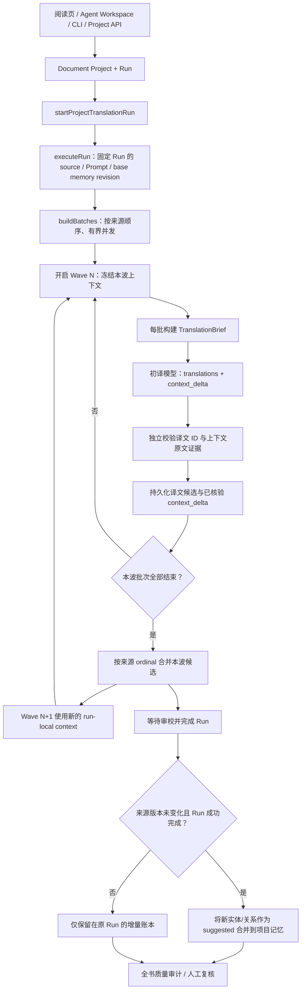

# Local Agent 文档/小说统一翻译 Pipeline

- 状态：当前实现说明
- 适用范围：`local-agent-service` 的项目级 EPUB/PDF/长文档与小说翻译
- 决策记录：[ADR-0001：统一本地翻译管线与初译上下文增量](adr/0001-unified-local-translation-context-delta.md)

本文说明本地文档翻译的统一执行路径，以及初译阶段如何返回并动态更新人物、实体和其他上下文。根目录 Cloudflare Worker 的短文本/网页翻译仍属于独立运行时，不应把长任务 Agent 编排移入 Worker。

## 1. 统一入口与责任边界

阅读页（包括“继续翻译下一待译页”和“强制重译当前页”）、Agent Workspace、CLI 和项目 API 都必须走同一个 Document Project / Run 执行器。入口可以选择当前页、章节、显式片段、全部或待更新片段等范围，但不能自行执行第二套本地翻译循环。

| 层 | 责任 |
|---|---|
| `fanyi-extension` 阅读页 / Agent Workspace | 展示文件和双语内容；选择范围；发起或停止 Run；呈现持久化进度、候选和审计结果 |
| Project API / CLI | 创建或恢复 Project/Run，校验请求和操作权限；不直接生成另一份翻译实现 |
| `translationAgent.ts` | 统一调度、批次切分、模型请求、响应校验、候选保存、审校、上下文增量合并、停止/恢复边界 |
| `translationBrief.ts` | 为每批构造有预算、来源版本固定、按原文序号过滤的只读上下文快照 |
| `translationContextDelta.ts` | 证据核验、增量合并、冲突保留；模型提出的任何事实都保持候选状态 |
| `projectStore.ts` | SQLite 事实来源：Run/片段状态、TranslationBrief、上下文增量、候选译文及项目记忆 revision |
| `qualityAudit.ts` | 全书缺失、术语/重复表达问题和不同批次候选译名冲突的审计入口 |



统一的是项目、调度、持久化、恢复、输出校验、审校、候选和审计契约；不要求小说、技术文档和短文本使用相同 Prompt。任务类型差异以同一执行器中的显式策略表达，不能按 UI 入口分叉。文学上下文增量对文学模式生效，非文学请求继续使用相同结构化翻译和候选生命周期，但不会把普通术语或代码片段强行建模成人物关系。

## 1.1 文学翻译前的全书预处理门禁（ADR-0005）

文学模式必须先完成当前原文版本的全书 Context Graph 预处理，再开始任何翻译模型调用。技术文档模式不要求这一步。

正常扩展路径如下：

1. 新文学项目建立后，扩展自动启动一次全书预处理，并从 `GET /api/documents/projects/:projectId/context-graph/status` 轮询轻量状态投影。
2. 预处理未完成、失败、状态未知、来源版本/分析版本/语言方向不匹配或完整性不足时，扩展对开始、重译、重试和恢复入口 fail closed，不创建文学翻译 Run。
3. 只有 readiness 通过后，扩展才开放文学翻译操作。失败、旧版本或语言变化不做无限自动重试；用户在“人物与预处理”中显式重新分析。
4. 服务端 `executeRun` 在 Run 进入 `running` 前再次检查，作为最终执行门禁。旧客户端或直接 API 调用可能先持久化 queued Run；服务端会有限地启动/等待匹配的 Context Graph，但在 readiness 通过前不读取待译片段、不调用翻译模型、不保存候选。
5. 状态与图谱事实只由服务端 SQLite 管理。扩展只消费小型 readiness/status DTO，不复制 nodes、edges、evidence 或章节摘要。

readiness 不是单看数据库 `status=completed`。它还要求 source revision、服务端当前分析版本、source/target language、受支持的策略 A/B、非零有效样本、完整的五项文风描述及至少一条 style rule；B 策略必须完成 style、characters、entities、relationships、chapters 五个阶段。styleAvoid 允许为空。机器文风基准完整不等于用户确认；机器应用与用户确认/编辑必须保留不同 provenance。

预处理失败不会降级为“只做逐章分析然后继续文学翻译”。失败阶段、缺失字段和错误通过服务端状态及 Run 事件诊断；重分析不得覆盖已采纳译文、人工修订或旧 Run 的固定快照。详见 [ADR-0005](adr/0005-literary-preprocessing-before-translation.md) 与 [完整流程说明](../FULL-BOOK-PREPROCESSING-FIRST-TRANSLATION-FLOW-2026-10-31.md)。

文学模式仍复用两个既有 Reviewer 任务，不新增 Agent 或模型调用。非中文目标语言保持原有顺序和行为。中文目标语言下，Style Review 改为真正的中文单语编辑：模型只接收中文初稿、目标语言人物声音描述、已确认中文风格规范和同一来源版本中更早已采纳的中文例句；不接收英文原文、英文引文、源语言人名/别名、源语言术语表、来源摘要或前文原文。编辑 finding 必须引用中文初稿中的 `targetExcerpt`。编辑候选随后交给 Accuracy / Terminology Review，与原文和初译对照复核；初译仅作为变化比较，不作为正确答案。只有双语复核完成的中文编辑候选才能被用户采纳，未完成复核时 Store 会拒绝应用。文风建议始终保持 pending，不静默覆盖已接受译文。详见根目录 [VOCAL-SAGA-LOCAL-AGENT-CHINESE-LITERARY-EDITING-RESEARCH-AND-IMPROVEMENT-PLAN-2026-10-31.md](../VOCAL-SAGA-LOCAL-AGENT-CHINESE-LITERARY-EDITING-RESEARCH-AND-IMPROVEMENT-PLAN-2026-10-31.md)。

## 2. 初译响应契约

文学初译除必需的 `translations` 外，还应返回有界的 `context_delta`。例子中的字段采用 snake_case，是模型协议的一部分；服务端将其验证后转换为内部类型。

```json
{
  "translations": [
    {
      "id": "segment-17",
      "translated_text": "国王朝麦克斯投去凶狠的一眼。"
    }
  ],
  "context_delta": {
    "entity_candidates": [
      {
        "local_id": "king",
        "canonical_source": "The King",
        "aliases": ["King"],
        "kind": "character_epithet",
        "target_proposal": "国王",
        "evidence": [
          {
            "segment_id": "segment-17",
            "quote": "The King shot a murderous glance at Max."
          }
        ],
        "reason": "同一称谓需要在后续片段中保持稳定译法"
      }
    ],
    "entity_mentions": [
      {
        "segment_id": "segment-17",
        "source_quote": "The King",
        "entity_ref": "king",
        "target_surface": "国王"
      }
    ],
    "relationship_deltas": [],
    "open_questions": [],
    "conflicts": []
  }
}
```

| 字段 | 用途 | 接受条件 |
|---|---|---|
| `entity_candidates` | 新人物、称谓、地点、物件、群体或别名的译名候选 | 当前批次的原文引文真实存在；规范来源名称出现在证据引文中；别名需有当前批次证据 |
| `entity_mentions` | 记录某个实体在具体片段中的来源表达和译文表面形式 | segment ID 属于当前输入；原文引文真实存在；`target_surface` 实际出现在同一片段的译文中 |
| `relationship_deltas` | 候选人物关系变化 | 证据片段存在，且关系双方名称都能在该源片段定位；关系语义仍是待核验候选 |
| `open_questions` | 保留身份、称谓、指代或上下文上的不确定点 | 问题必须关联可核验的当前批次来源证据 |
| `conflicts` | 显式报告本批发现的解释/映射冲突 | 冲突需有来源证据；合并时保留为待核验信息 |

`context_delta` 中的模型状态、置信度或“已确认”字样都不具有授权效力。项目级记录统一保留为 `suggested/candidate`，人工确认仍使用现有记忆审核入口。

上下文元数据与译文分开验收。缺失、截断或无效的 `context_delta` 会被丢弃并记录诊断，但只要 `translations` 本身通过结构校验，译文仍然保存。这保证上下文抽取质量不佳时不会连带丢掉有效的初译。

## 3. 验证与动态合并策略

### 3.1 证据核验

`translationContextDelta.ts` 按以下规则校验上下文增量：

1. 引用的 `segment_id` 必须属于本次模型请求的当前 `segments`，不能引用 `precedingSegments`、后续批次或任意书籍位置。
2. `quote` 必须是对应原文片段内能匹配的连续文本；仅有模型解释或无法核验的引文不接受。
3. 候选规范名称必须出现在它自己的证据引文中；别名必须能在本批原文证据中定位，避免仅凭相似拼写把两个角色合并。
4. `entity_mentions.target_surface` 必须出现在该 segment 的实际返回译文中。未命中的 mention 不作为已核验落点。
5. 关系候选必须带来源证据，而且双方名称在引文所在的原文片段中都能定位。这个确定性检查不能证明谓词语义正确，因此关系不会自动确认。
6. 每批各类记录都有数量和字符串长度上限。超出上限、结构错误或无效证据按记录丢弃，生成计数诊断，不覆盖有效译文。

### 3.2 波次边界

不能在全局并行批次之间立即更新共享内存，否则模型响应的完成先后将决定其他批次的知识，造成不可复现的译名，也可能把后文信息泄漏给原文顺序更早的批次。因此执行器把批次划分为有界 wave：

- 在每一波开始时，读取此前已有的 context-delta 记录，筛选首片段来源 ordinal 严格早于本波首片段的增量，并从 Run 的基础记忆构建本波上下文。
- 同一波中的批次并行运行，所有批次看到相同的上一波记忆快照。某个批次先结束并不能影响本波另一个批次。
- 每个批次仍按相同的 TranslationBrief 策略构建上下文快照。初译和两个 Reviewer 共用各自批次的同一快照；Reviewer 不读取下一波或实时变更的记忆。
- 本波完成后读取持久化的增量，按原文来源 ordinal 排序合并，再启动下一波。
- 暂停或进程重启后，Run 的 context-delta 账本可用于重新构建下一波记忆。若恢复后前面的片段先补译，已经保存的后文增量不会提前注入；只有其来源 ordinal 确实位于当前批次之前时才可见。

### 3.3 冲突优先级与持久化

合并遵循明确顺序：

1. 人工确认的规范译名、别名和关系不会被模型候选改写。
2. 相同来源实体且目标译名相同的候选可以增加有证据的别名或补充候选关系。
3. 同一来源实体出现不同候选译名时，保留原有/来源顺序中的首个目标，记录明确的 open question；禁止静默覆盖或全局替换。
4. 名称相同不等于实体相同。合并只根据明确的 source/alias 集合重合以及兼容的实体类型进行，不使用任意子串模糊匹配。
5. 每个批次的已验证增量写入项目 SQLite 的 `translation_context_deltas` 表，幂等键为 `(run_id, first_segment_id)`，同时保存 `batch_index`、来源 ordinal、来源片段 ID、增量 JSON、验证计数及时间。重试同一批时可更新这一批的记录，其他批次记录不删除。
6. 只有 Run 成功完成且项目当前来源 revision 仍与 Run 一致时，才把最终候选合并进当前文学记忆 revision。新增实体和关系同时保留 `evidenceRefs: [{ segmentId, sourceQuote }]`。每次构建 TranslationBrief 时，实体/关系证据都必须通过来源版本、segment ID、引文匹配和 ordinal 过滤；不能因为同一称谓在早期出现过，就把后文才有证据的映射注入早期片段。新增数据仍为 suggested；来源已经改变或 Run 中断时不把旧证据写入全局记忆，而保留在原 Run 的账本里。

项目记忆合并只更新可复用的结构化候选，不直接改写历史译文。全局质量审计新增 `context-delta-conflict` finding，用于定位多个批次提出的冲突译名；finding 是人工审查入口，不自动启动返工，也不自动应用译文修改。

### 3.4 作品级 Chinese Editorial Profile

中文目标语风格档案与 Context Graph 的 Source Author Voice 分开维护。前者只描述已采纳中文译文中可观察到的目标语表达习惯；后者仍描述原文作者/文本特征，不能把两者混为同一份 styleGuide。

- 用户采纳译文后，Local Agent Service 自动检查当前 source revision 的 accepted translation ledger。达到最少样本量后，复用 `planBookSamples` 从已采纳片段中做章节/位置/对白覆盖抽样。
- 原文只在本机用于确定性抽样；发送给档案分析模型的 Prompt 只包含中文已采纳译文和 segment ID，不包含 source、原文引文、英文人名、glossary 或 Context Graph。
- 模型输出的是候选 `chineseEditorialProfile`，包括叙述声音、语域、节奏、对白、词汇、规则和避免事项；每条观察必须引用其中文样本中真实存在的连续片段。
- Project Store 将 profile 作为 LiteraryMemory 的不可变 revision 保存，并逐条核验 segment ID、当前 source hash、已采纳译文和 target excerpt。证据不足或原文版本变化时，confirmed 自动降级为 candidate。
- 候选档案不会注入翻译或中文编辑 Prompt。用户通过 `POST /api/documents/projects/{projectId}/literary-memory/chinese-editorial-profile/review` 明确确认后，才会进入后续 TranslationBrief 的目标语上下文；拒绝后不再注入。
- profile 与 source revision 绑定。新原文版本不能继承旧版本的确认状态；旧 Run 的 TranslationBrief 仍保留其创建时的 memory revision 和上下文快照。

该流程不新增数据库表或独立 Agent；使用现有 BookScan、LiteraryMemory revision、Project Store 和 `styleReview` 任务模型配置。档案分析只在有新的已采纳译文时按需运行，不在每个翻译批次重复调用。

## 4. 事件与可观测性

与增量相关的事件包括：

| 事件 | 主要字段 |
|---|---|
| `translation.context-delta.parsed` | 本次请求接受/拒绝的实体候选、提及、关系、问题和冲突计数 |
| `translation.context-delta.saved` | 批次首片段、来源片段数量、已持久化候选计数、是否可供后续 wave 使用 |
| `translation.context-wave.ready` | wave 序号、首来源 ordinal、可见的前序增量数量、候选数量、策略标识 |
| `translation.context-memory.persisted` | 新 memory revision、合并摘要、候选/关系冲突计数 |
| `translation.context-memory.skipped` | Run 与当前 source revision 不一致时的跳过原因 |
| `translation.context-memory.unchanged` | 本轮没有产生新的可持久化候选时的原因 |
| `context-graph.source-index.ready` | 来源 revision 的索引版本、片段数、实体/句子/数量特征数、截断状态及是否为旧项目惰性升级 |

事件记录计数和版本，不记录完整原文、完整译文或整个模型 Prompt。精确的来源引文仅在项目的上下文增量账本中与 Run/segment ID 一起保存，继续遵循本机文档数据的存储范围。

### 4.1 M1/M2：来源特征索引与确定性质量发现

`bookScan.ts` 在一次全书预处理时生成 `book-scan-index-v2` 特征索引，按当前不可变 source revision 持久化到 `context_graph_source_features`，同时在 `context_graph_meta.sourceFeatureIndex` 记录索引版本、片段数、特征条数及截断情况。索引包含：

| 特征 | 保存的信息 | 使用边界 |
|---|---|---|
| 实体/称谓候选 | 原文表面形式、NFKC/大小写规范形式、类型、来源 segment ID、UTF-16 字符偏移、是否位于对白段 | 词法候选只指导样本选择，不等同于实体识别或身份确认 |
| 句子/引语 | sentence/quotation 类型、规范文本、字符起止位置 | 重复表达审计优先使用实际原文范围；不能可靠对齐目标语范围时只产生人工复核提示 |
| 对白信号 | 引号范围、引述动词/破折号线索、对话分数 | 只表示对白可能性，不声明确定说话人 |
| 数量/单位 | 来源文本、字符偏移、规范单位和单位族 | 作为审计与抽样线索，不独自判断合法换算或复杂数量语义 |

索引以 `source_revision_id + segment_id` 为主键。读取索引必须同时检查版本、片段总数及每行 JSON 形状；缺失或不完整的索引会返回 `null`，调用方退回确定性扫描，而不是读取另一个来源版本的索引。索引位置使用 JavaScript UTF-16 offset，与 `String.slice(start, end)` 对齐。

当前预处理仍以 72 个样本和每个样本 850 个原文字符为模型预算上限。代码先对全文建立词法索引，再利用名称出现分布、早/中/晚位置、重复句/引语和对白密度选择样本；传给模型的候选名称会附带仅限于实际送入模型文本的表面形式和偏移。采样扫描的候选列表不是模型事实，模型结论仍必须引用样本原文。

M1 的确定性质量检查包括三项：

- 重复表达发现区分完整源句与长段落中的嵌入引语。只有完整源句可可靠比较完整译文；对于有单一可定位目标语引语的重复台词，比较引语本身，而不是周围叙述。无法建立目标语对齐时生成不可自动返工的 `repeated-expression-alignment-review` 提示。
- 对初译 `context_delta.entity_mentions` 的原文引文和译文落点再次校验，并按规范名称/显式别名分组。若多个片段的目标表面形式不同，则产生 `entity-mention-drift` finding。它是复核提示，不自动统一称谓，不使用模糊子串合并实体。
- 初译与 Reviewer 都读取人物角色/声音中**已确认、启用翻译**的规范原文名/译名；该资料即使没有对应 `entities` 记录，也会进入批次内可见的名称映射。已启用的候选画像可以作为弱提示，但不进入强制保护。称谓型通用词和与规范名不一致的拉丁别名会被过滤，后续章节才出现的别名不得提前注入。
- 如果 LiteraryMemory 与人物角色/声音对同一原文名给出不同的已确认译名，TranslationBrief 会移除这组冲突的强制映射并记录冲突提示，而不是根据数组顺序选一个；全书审计也会生成不可自动返工的 `canonical-name-mapping-conflict` finding，必须先人工统一项目记忆。
- 中文目标语言的全书审计会额外标记疑似英文残留（例如译文里漏掉的普通英文词或整句）。它是启发式复核项，不会自动改写译文；专名、原文引用或刻意保留的外语可能需要人工排除。
- Project Store 只允许在项目初始化时从旧阅读器迁移记忆；普通 Prompt revision 和 Run 请求不能携带另一份文学记忆以隐式覆盖服务端版本。后续记忆修改必须走显式 `/literary-memory` 入口。

全书质量审计优先复用本 source revision 的特征索引，以同一套 sentence/quotation 边界构建重复表达候选；缺失索引时采用相同扫描算法现场回退。审计报告会显示 `sourceFeatureIndexVersion`、`sourceFeatureIndexUsed` 和索引覆盖的片段数，便于区分使用已持久化索引和兼容回退。

## 5. 质量门与回归测试

新增/更新的验证重点：

- `tests/translation-context-delta.test.mjs`：当前批次证据约束、伪造/越界引文拒绝、译文表面形式核验、已确认译名保护、冲突候选的确定性合并。
- `tests/document-agent-prompt.test.mjs` 与 `tests/translation-brief.test.mjs`：检查 TranslationBrief 的时间边界、共享快照、Prompt payload，以及 dynamic entity evidence 不得向早期 segment 泄漏。
- `tests/quality-audit.test.mjs`：全书缺译、确认术语漂移、人物角色/声音单独维护的规范译名、规范名冲突、英文残留和重复表达审计；所有修订仍通过窄范围候选 Run 供人工采纳。
- `npm test`：运行本地服务完整回归集；`npm run quality:fiction-baseline`：运行小说质量控制样本。

测试夹具证明确定性验证和边界行为，不代表真实模型翻译质量已经提高。质量收益仍需在同一 source revision、语言方向和相同 segment 集合上进行 before/after 对照，并结合人工检查人物身份、称谓和声音是否稳定。

## 6. 不在本次架构内的事情

- 不在 Cloudflare Worker 内执行书籍级多阶段 Agent 或持久化 Context Graph。
- 不在 `fanyi-extension` 里复制 `context_delta` 校验、实体合并和持久化逻辑。
- 不做跨全文本字符串替换，不因自动建议而改写已采纳译文。
- 不把模型生成的人物身份、关系、别名或译名直接标为 confirmed。
- 不让同波批次相互观察尚未完成的增量，也不把后文证据注入早期原文片段。


### 3.5 中文文学编辑质量指标

全书 Quality Audit 除原有翻译质量指标外，增加 `metrics.chineseEditorial`：

- 编辑覆盖：reviewed / unchanged / uncovered segment 数。
- 编辑行为：edited segment 数、edit rate、unchanged rate。
- 双语复核：verified、corrected、pending finding 数。
- 用户决策：applied、dismissed、pending finding 数和已决策建议采纳率。
- 后续人工覆盖：已采纳编辑建议之后，如果最新 accepted translation 被新的人工译文覆盖，记录为 `manuallyOverriddenAfterApplyCount`。它是后续覆盖的观测值，不直接等同于编辑错误或 over-edit。

指标来自 `stage.completed` 持久化事件和 `review_findings`，按 source revision 与对应 Run 归集。没有中文单语编辑阶段记录时，指标为 0/null，不把缺失数据解释为编辑质量达标。Quality Audit 同时记录当前 `chineseEditorialProfile` 的状态、来源版本、分析版本、样本 fingerprint 和证据数。


## 当前统一规则：默认采纳、事后纠正（2026-10-31，优先于本文旧描述）

- 模型产生的当前最佳结果在通过来源/结构完整性校验后默认参与后续翻译；不得要求用户逐项确认人物、实体、关系、声音、文风或普通审校发现。
- `model-default` 是机器默认采纳，不是用户确认。用户修改、确认和拒绝必须分别记录；`user-modified` 与 `user-confirmed` 均优先于机器默认结果。
- 用户拒绝/删除必须持久化，重新分析、记忆刷新、TranslationBrief 合并不得自动恢复。不得仅删除 UI 或 LiteraryMemory 投影而让 Context Graph 原记录继续注入。
- 证据不完整只影响置信度、可用范围和约束强度，不得仅因文风字段、画像维度、关系证据覆盖不完整而阻断翻译。
- 保留原文版本、语言方向、来源绑定、未来章节隔离、译文写回位置和数据完整性等硬约束。只有缺少不可替代输入、数据损坏或执行无法继续等技术异常才暂停。
- 自动应用必须保留来源与版本记录，且不得覆盖用户修改；用户可以事后修改或拒绝。
- 任何旧段落中要求“候选必须人工确认”“证据完整后才能启用”“风格字段必须齐全”的规则均已被本节取代。
